# Infinite Minesweeper

Minesweeper on a grid with no edges. Reveal cells, flag mines, and turn 8×8 sectors green by clearing them completely. Your board is saved to your account, so the territory keeps growing between sessions.

**Play it at [minesweeper.almostapps.eu](https://minesweeper.almostapps.eu/)**

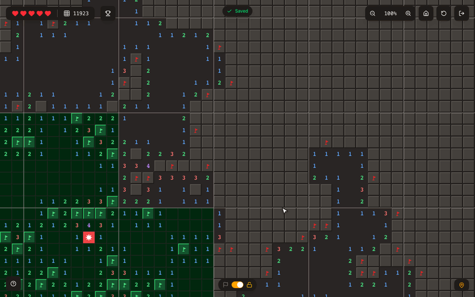

## How it plays

- **The grid never ends.** Mines are placed by a hash of each cell's coordinates and a per-game seed, so any part of the board can be generated on demand and it is the same every time you come back.
- **Your first click is always safe.** It clears the mines in a 5×5 area around the cell, which guarantees an opening to start from.
- **Sectors.** The board is split into 8×8 sectors. A sector is finished when every safe cell is revealed and every mine is flagged (or was hit), and it turns green.
- **Five lives.** Hitting a mine costs a life instead of ending the game. A life comes back every 3 minutes, including while you are away. At zero lives you wait for the next one.
- **Zoom from 10% to 200%.** At 50% and below the board switches to a sector map: grey for untouched, lighter grey for in progress, green for finished. Clicking a sector flies you back in to it.
- **Map export.** At 10% zoom you can download your territory as a PNG: 100×100 sectors around the start, with your nickname, tiles cleared, sectors finished, and the percentage explored.
- **Auto-save and multiple devices.** Progress saves one second after your last move. If another device saved in the meantime, the game asks which save to keep.
- **Leaderboard** ranked by tiles opened.
- **Guest play.** Play without an account under a generated nickname, then add an email and password later to keep the progress.
- **Phones.** Tap to reveal, long-press to flag, and a switch at the bottom swaps the two. Pinch to zoom.

## Screenshots

|                                                                                                                               |                                                                                                            |
| ----------------------------------------------------------------------------------------------------------------------------- | ---------------------------------------------------------------------------------------------------------- |
| 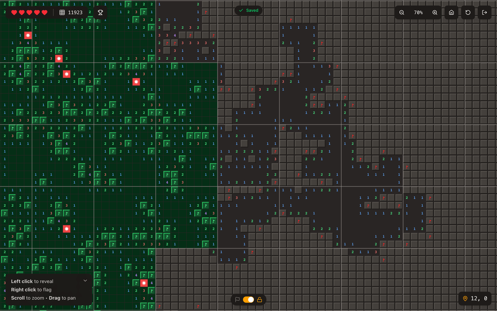 | 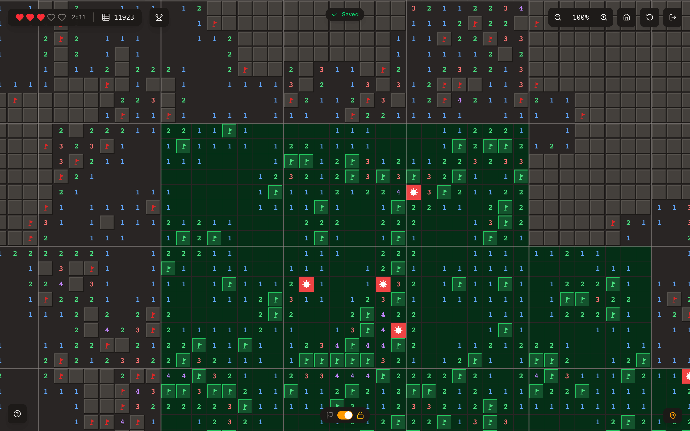 |
| The edge of a finished area. Green sectors are done; the grey ones on the right are still being worked on.                    | Lost lives regenerate one at a time, with the countdown next to the hearts.                                |
| 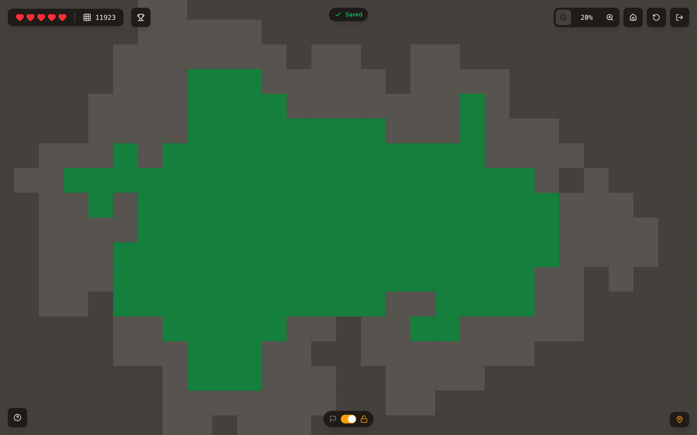                                                                    | 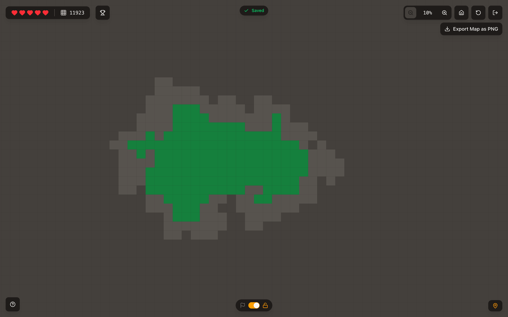                   |
| Zoomed out, every sector becomes one block.                                                                                   | At 10% the whole territory fits on screen and the PNG export appears.                                      |
| 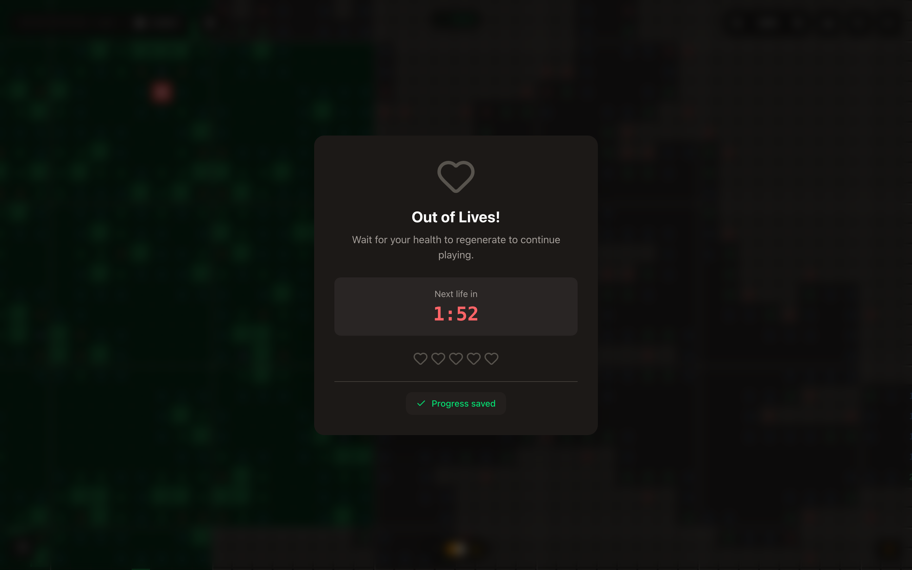                                                       | 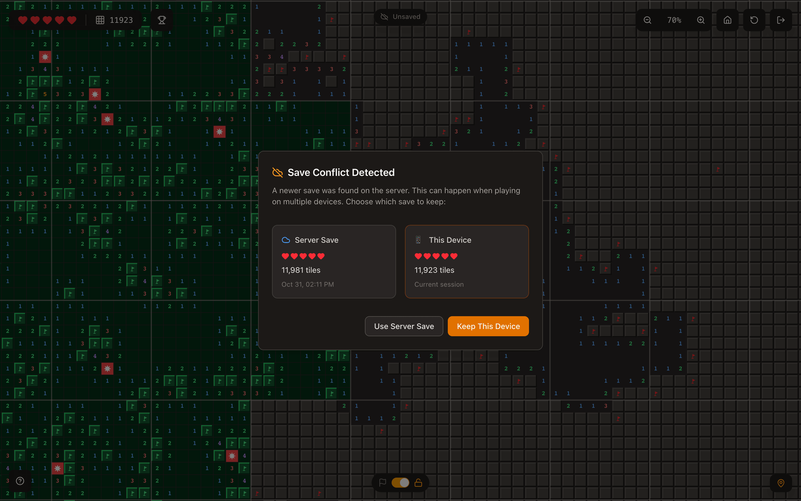      |
| Out of lives: the board locks until a life comes back.                                                                        | Played on two devices? Pick which save wins.                                                               |
| 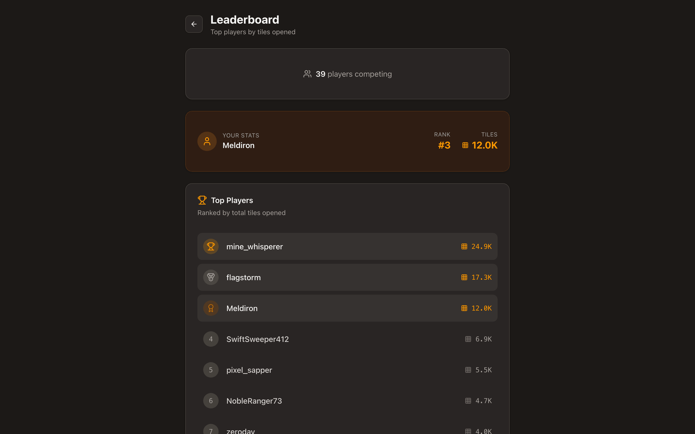                                             | 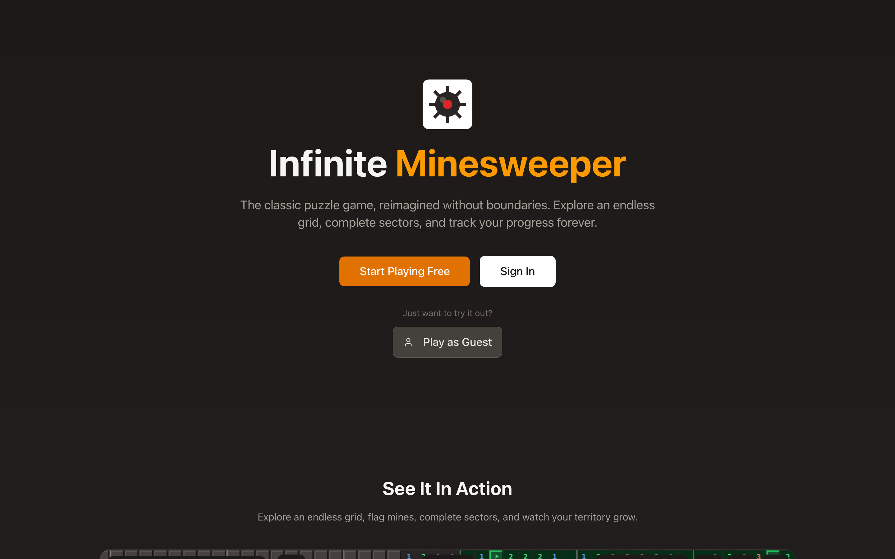                                                         |
| Leaderboard, with your own rank pinned on top.                                                                                | Landing page with sign up, sign in, and guest play.                                                        |
| 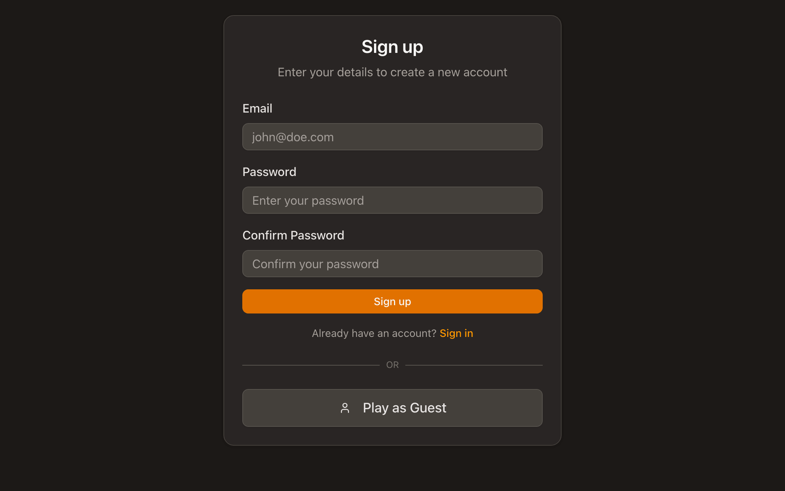                                                             | 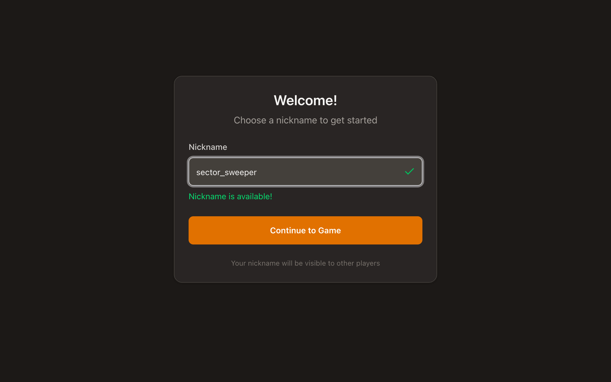                        |
| Sign up with email and password, or skip it.                                                                                  | New accounts pick a unique nickname for the leaderboard.                                                   |
| 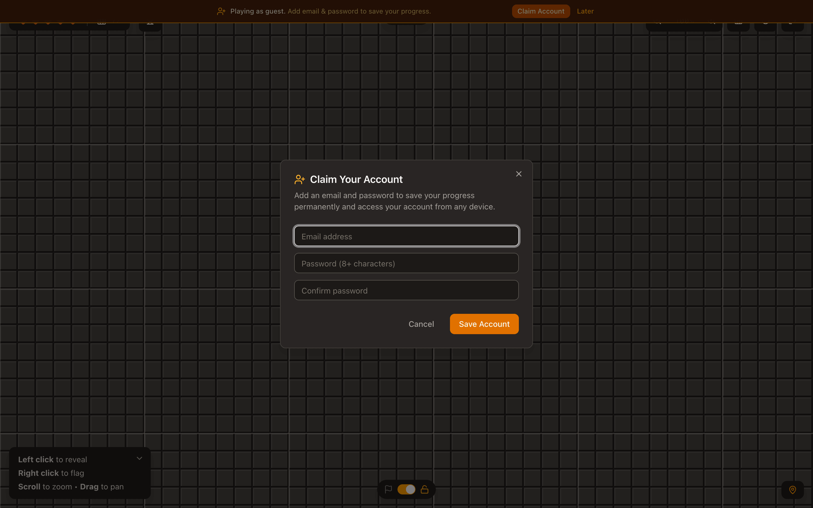                                                | 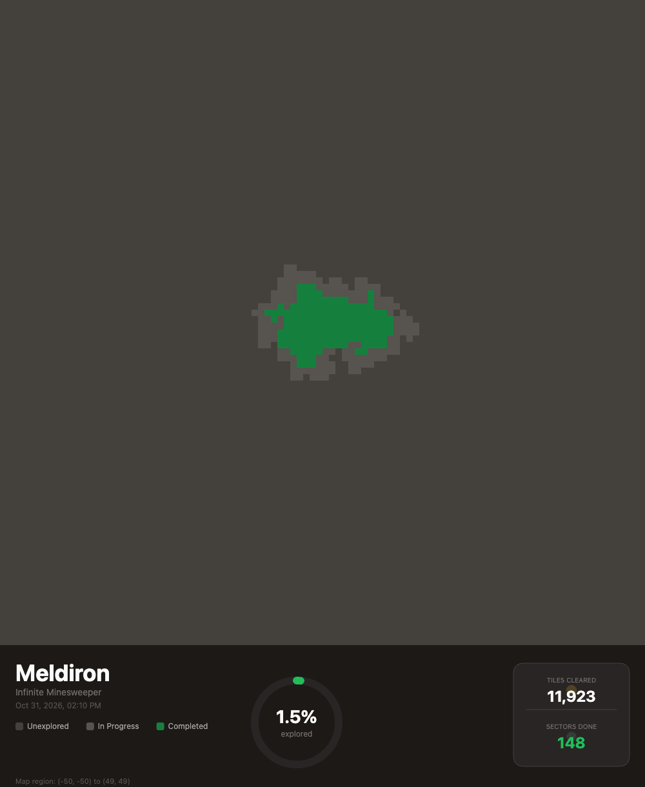                   |
| Guests can claim their account at any time without losing progress.                                                           | An exported map, ready to share.                                                                           |

<p align="center">
  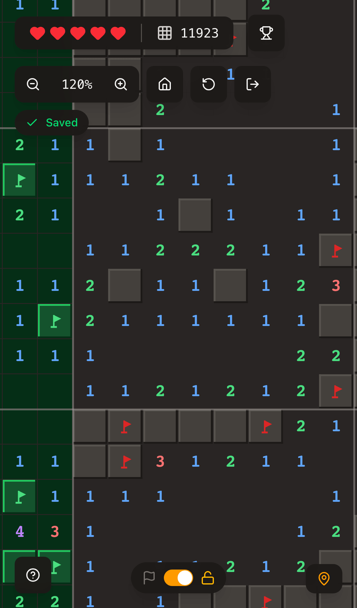
  &nbsp;&nbsp;
  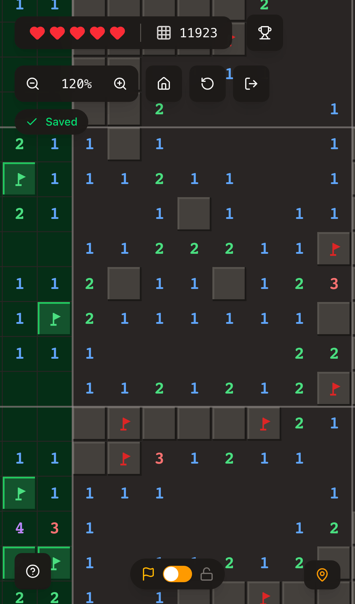
</p>
<p align="center">On a phone, the switch at the bottom flips taps between revealing and flagging.</p>

## Tech stack

- A static single-page app: React 19 with [TanStack Router](https://tanstack.com/router) file-based routing, built with [Vite](https://vite.dev/)
- [Tailwind CSS](https://tailwindcss.com/) v4 and [shadcn/ui](https://ui.shadcn.com/) components
- The board is drawn on a single `<canvas>`. Below 50% zoom it draws one block per sector instead of individual cells
- [Appwrite](https://appwrite.io/) for accounts (email and password, anonymous guest sessions) and the database: saves, preferences, nicknames, and leaderboard stats. The browser talks to Appwrite directly with the [web SDK](https://appwrite.io/docs/sdks)
- One [Appwrite Function](https://appwrite.io/docs/products/functions) that checks rows in the background, so players never wait for it

The game logic lives in [`src/components/minesweeper`](src/components/minesweeper): `useInfiniteGrid.ts` holds the rules (mine placement, flood fill, chording, sectors, lives), `CanvasRenderer.tsx` draws the board, and `MinesweeperGame.tsx` handles input, zoom, saving, and the PNG export. Calls to Appwrite are in [`src/lib/api`](src/lib/api), and the background checks are in [`functions/game`](functions/game/src/main.js).

### Who can write what

There is no server of our own and no API key in the app. Players read and write their own rows with the web SDK, and Appwrite enforces the rules:

| Table                         | Row ID  | Players can                                     | Leaderboard-relevant checks                                |
| ----------------------------- | ------- | ----------------------------------------------- | ---------------------------------------------------------- |
| `minesweeper_saves`           | user ID | create, read and update their own row           | the function recounts tiles from it                        |
| `user_preferences`            | user ID | create, read and update their own row           | none                                                       |
| `user_onboarding` (nicknames) | user ID | create and update their own row, read every row | unique index on `nickname`; the function checks the format |
| `user_stats` (leaderboard)    | user ID | read every row                                  | only the function writes it                                |

A player can only grant permissions to their own user role, so a row whose ID matches the one user in its permissions was created by that user. Nobody can delete rows or write `user_stats`.

The [`game` function](functions/game/src/main.js) never sits in the player's way: nobody can call it (its execute list is empty), it only runs on row events, in the background. On every create or update it reads the stored row and:

- deletes rows whose ID does not match their owner (extra rows, attempts to squat someone else's ID),
- deletes a nickname that breaks the rules (2 to 32 letters, numbers, `_` or `-`), together with that player's leaderboard row,
- creates or renames the player's leaderboard row for a valid nickname,
- recounts opened tiles from the stored save after every save.

## Running locally

You need [Bun](https://bun.sh/) and an Appwrite project set up from [`appwrite.json`](appwrite.json).

```bash
bun install
cp .env.example .env.local   # then fill in the values below
bun run dev                  # http://localhost:3000
```

| Variable                   | Description                                                            |
| -------------------------- | ---------------------------------------------------------------------- |
| `VITE_APPWRITE_ENDPOINT`   | Your Appwrite endpoint, for example `https://fra.cloud.appwrite.io/v1` |
| `VITE_APPWRITE_PROJECT_ID` | Project ID                                                             |
| `VITE_APPWRITE_DB_ID`      | Optional, defaults to `imagine-project-db`                             |

All of these end up in the public bundle, which is fine: they are not secrets. Add `localhost` and your site hostname as Web platforms in the Appwrite project.

[`appwrite.json`](appwrite.json) defines the database, its four tables (with `create("users")` on the three player-owned ones and row security on all of them) and the `game` function (Node 22, no execute permissions, scopes `rows.read` and `rows.write`, triggered by row create and update events). Change `projectId` to your project and push it with the [Appwrite CLI](https://appwrite.io/docs/tooling/command-line/installation).

Other scripts:

```bash
bun run build   # type-check and build the static site into dist/
bun run start   # preview dist/ locally
```

## Deploying to Appwrite Sites

The live game is a static site on [Appwrite Sites](https://appwrite.io/products/sites):

| Setting          | Value                                                                                                                                                                          |
| ---------------- | ------------------------------------------------------------------------------------------------------------------------------------------------------------------------------ |
| Framework        | React, static adapter                                                                                                                                                          |
| Install command  | `npm install --prefix ./.bun-tool --no-audit --no-fund bun@1.3 && node ./.bun-tool/node_modules/bun/install.js && ./.bun-tool/node_modules/.bin/bun install --frozen-lockfile` |
| Build command    | `./.bun-tool/node_modules/.bin/bun run build`                                                                                                                                  |
| Output directory | `./dist`                                                                                                                                                                       |
| Fallback file    | `index.html`                                                                                                                                                                   |
| Variables        | `VITE_APPWRITE_ENDPOINT`, `VITE_APPWRITE_PROJECT_ID`                                                                                                                           |

Dependencies come from `bun.lock`. A plain `npm install` resolves newer TanStack packages than the lockfile and can break the build. The Sites build image skips npm install scripts, so the `bun` npm package is installed into `.bun-tool` and its `install.js` is run by hand to link the binary.

Deploy the function from `functions/game` with `npm install` as its build command.

For the safest sessions, serve the site and the Appwrite API from custom domains on the same registrable domain (for example `minesweeper.example.com` and `appwrite.example.com`). Appwrite then keeps the session in a first-party, httpOnly cookie. On a different domain, browsers that block third-party cookies make the SDK fall back to `localStorage`.

## Credits

Built with [Imagine](https://imagine.dev/), the AI web builder from [Appwrite](https://appwrite.io/), as one of the projects I made while QA testing it.
